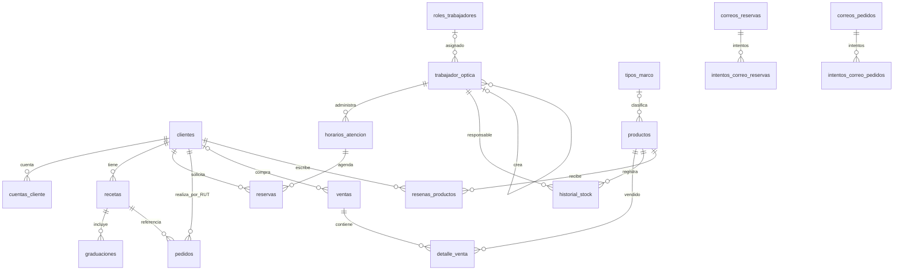

# Base de datos

## Motor y fuentes

La aplicación utiliza MySQL 8.0 (Compose principal y Compose E2E) con `utf8mb4` y `utf8mb4_unicode_ci`. El nombre configurado por Compose es `optica_db`. El esquema canónico de inicialización está en `database/schema.sql`; `database/insert.sql` aporta datos de ejemplo. La base E2E importa el mismo esquema y su seed sintético separado. EF Core se configura en `Optica.Api/Data/OpticaDbContext.cs` mediante el proveedor MySQL.

## Tablas

| Tabla | Propósito/columnas destacables |
|---|---|
| `clientes` | `id_cliente`, `rut`, `nombre`, `apellido`, `telefono`, `correo`, `estado`, `fecha_registro`; RUT y correo son únicos. |
| `cuentas_cliente` | Cuenta/credenciales de acceso del cliente; FK única a cliente. No se documentan ni exponen hashes. |
| `recetas` | Receta vinculada a cliente; PK `id_receta`, FK `id_cliente`. |
| `graduaciones` | Valores de graduación por receta y ojo; FK `id_receta`, restricción única receta/ojo. |
| `catalogos` | Valores de catálogo por tipo; combinación tipo/nombre única. |
| `tipos_marco` | Tipos de marco y sus datos de diseño/estado. |
| `productos` | `codigo`, `nombre`, marca/modelo/color, `categoria`, `precio`, `stock`, `stock_minimo`, estado `Disponible`/`Agotado`, imagen y tipo de marco opcional. |
| `pedidos` | `rut`, `id_receta` opcional, `fecha`, estado (`Pendiente`, `En proceso`, `Listo`, `Entregado`, `Cancelado`), `total`, `anotaciones`. |
| `ventas` | Cabecera con `id_cliente` opcional, `fecha` y `total`. |
| `detalle_venta` | `id_venta`, producto opcional, nombre, cantidad, precio unitario y subtotal. FKs a venta y producto. |
| `roles_trabajadores` | Rol de personal y permisos serializados. |
| `trabajador_optica` | Personal, tipo de usuario, rol y administrador creador. Check limita tipo a Administrador/Trabajador y exige rol al trabajador. |
| `historial_stock` | Movimientos/historial de stock, producto y trabajador responsable; ambas relaciones restringen eliminación. |
| `horarios_atencion` | `id_administrador`, `fecha`, `hora_inicio`, `hora_fin`, estado `Habilitada`/`Inhabilitada`; combinación fecha/hora de inicio única. |
| `reservas` | Cliente, horario, motivo, hashes de tokens y marcas de recordatorio; estado `Pendiente`, `Confirmada`, `Cancelada` o `Realizada`. La API controla reserva activa única por horario. |
| `correos_reservas` | Cola de notificaciones con `id_reserva`, `id_horario`, tipo, destinatario, asunto, cuerpo HTML protegido y reintentos. El esquema no declara FK para `id_reserva` ni `id_horario`. |
| `intentos_correo_reservas` | Registro de intentos vinculado a correo de reserva; FK con borrado en cascada. |
| `correos_pedidos` | Cola de notificaciones con `id_pedido`, destinatario, cuerpo y estado de envío; `id_pedido` no tiene FK declarada en el esquema. |
| `intentos_correo_pedidos` | Intentos asociados a correo de pedido; FK con borrado en cascada. |
| `tipos_rostro` | Tipos de rostro administrables para la recomendación. |
| `formas_lente` | Formas de lente usadas por el módulo de marcos. |
| `resenas_productos` | Reseña de cliente/producto; calificación 1–5 y una reseña por cliente/producto. |

## Relaciones y restricciones destacadas

Además de las claves primarias, el esquema declara índices para recetas/cliente, pedidos/cliente y estado, reservas/horario y recordatorios, categoría/stock de productos, unicidades de cuenta/horario/catálogo/reseña y checks de tipo de personal/calificación. Las FKs especifican reglas de borrado: por ejemplo, producto→tipo de marco y venta→cliente usan `SET NULL`; historial stock restringe borrar producto/responsable; detalle de venta referencia sus padres. Consulta `schema.sql` para longitudes, tipos y reglas exactas.

## Inicialización y actualización

Para una instalación nueva, aplicar `database/schema.sql` a una base MySQL vacía con una cuenta autorizada para crear el esquema y sus tablas. En la nube, confirmar previamente el nombre de la base asignada y los permisos disponibles. Los datos de ejemplo de `database/insert.sql` y los datos sintéticos de `database/e2e/` se reservan para entornos de prueba.

Para una base existente, revisar el esquema instalado y aplicar solo los cambios pendientes. `database/migraciones/` contiene scripts SQL para cambios concretos, como la actualización de la clave foránea de pedidos y la creación de las tablas de encuestas. Antes de aplicar cambios en producción, disponer de un respaldo y validar los scripts en un entorno con la misma versión de MySQL.

## Despliegue en la nube

La API recibe su conexión mediante `ConnectionStrings__OpticaDb`. Configurarla en el gestor de secretos del entorno y usar TLS según la configuración del servicio MySQL. Confirmar en cada despliegue la versión del motor, los permisos para aplicar cambios de esquema y la política de copias de seguridad.

## Verificación de índices y paginación

Se usó `EXPLAIN ANALYZE` en MySQL 8.4 con 100.000 filas sintéticas por tabla operativa y 1.000 por tabla de encuestas. Los tiempos corresponden a una ejecución por escenario y miden las consultas SQL por separado.

| Consulta e índice | Sin índice (ms) | Con índice (ms) | Decisión |
|---|---:|---:|---|
| Ventas recientes, `idx_ventas_fecha` | 61 | 0,069 | Conservar. Las ventas se acumulan de forma continua y el índice permite obtener las más recientes en orden sin leer toda la tabla. |
| Ventas por rango, `idx_ventas_fecha` | 46,2 | 24,2 | Conservar. El mismo índice acota las ventas al período del ranking. Se reutiliza para el historial y el filtro por fecha. |
| Catálogo, `idx_productos_nombre` | 192 | 0,089 | Conservar. La consulta puede devolver los primeros 20 productos en orden sin ordenar todo el catálogo. El beneficio aumenta cuando hay más productos que los que caben en una página. |
| Pedidos atrasados, `idx_pedidos_fecha` | 91,2 | 4,94 | Retirar. MySQL usó el índice con un 1 % de atrasos en la muestra. El seguimiento de atrasos no requiere ese nivel de respuesta y se evita el costo de mantener el índice. |
| Pedidos por RUT, `idx_pedidos_rut_fecha` | 0,441 | 0,386 | Retirar. El índice simple por RUT cubre el filtro y la clave foránea. Ordenar los pedidos del cliente por separado añadió solo 0,055 ms en la prueba. |
| Stock por producto, `idx_historial_stock_producto_fecha` | 0,417 | 0,335 | Retirar. El índice de la clave foránea ya permite localizar los movimientos del producto. El compuesto ahorró 0,082 ms en la prueba. |
| Stock reciente, `idx_historial_stock_fecha` | 90,3 | 0,069 | Retirar. La mejora fue considerable con 100.000 movimientos sintéticos, pero el historial tiene menor prioridad operativa. Cada movimiento nuevo exige actualizar el índice. Se espera un inventario de hasta unos 200 productos. El historial puede acumular varios movimientos por producto. |
| Encuestas enviadas, `idx_encuestas_fecha_envio` | 0,563 | 0,259 | Retirar. El conteo por período ahorró 0,304 ms en la prueba con 1.000 filas. Ese ahorro en la consulta del informe aporta poco frente al espacio y al mantenimiento del índice cada vez que se registra un envío. |
| Comentarios de encuestas, `idx_respuestas_encuesta_fecha` | 0,967 | 0,107 | Retirar. La consulta de comentarios ahorró 0,860 ms en la prueba con 1.000 filas. La mejora se concentra en la revisión de comentarios por período, mientras que el índice se actualiza con cada nueva respuesta. |

MySQL puede preferir un escaneo y ordenamiento en tablas pequeñas, incluso cuando existe un índice compatible.

En cada despliegue, usar `SHOW INDEX` para comprobar qué índices están instalados y `EXPLAIN ANALYZE` para verificar cuáles usa MySQL. Al retirar un índice que respalda una clave foránea, verificar primero que exista otro compatible. Para cambiar índices sin copiar las tablas, usar `ALGORITHM=INPLACE, LOCK=NONE` donde sea compatible.
