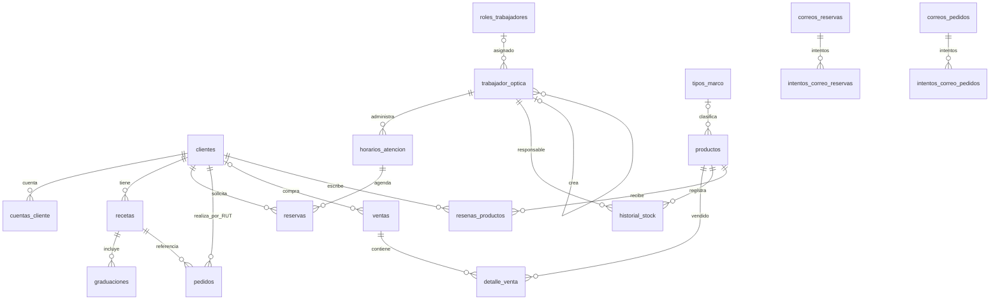

# Base de datos

## Motor y fuentes

La aplicación utiliza MySQL 8.0 (Compose principal y Compose E2E) con `utf8mb4` y `utf8mb4_unicode_ci`. El nombre configurado por Compose es `optica_db`. El esquema canónico de inicialización está en `database/schema.sql`; `database/insert.sql` aporta datos de ejemplo. La base E2E importa el mismo esquema y su seed sintético separado. EF Core se configura en `Optica.Api/Data/OpticaDbContext.cs` mediante el proveedor MySQL.

## Tablas

| Tabla | Propósito/columnas destacables |
|---|---|
| `clientes` | `id_cliente`, `rut`, `nombre`, `apellido`, `telefono`, `correo`, `estado`, `fecha_registro`; RUT y correo son únicos. |
| `cuentas_cliente` | Cuenta/credenciales de acceso del cliente; FK única a cliente. No se documentan ni exponen hashes. |
| `recetas` | Receta vinculada a cliente; PK `id_receta`, FK `id_cliente`. |
| `graduaciones` | Valores de graduación por receta y ojo; FK `id_receta`, restricción única receta/ojo. |
| `catalogos` | Valores de catálogo por tipo; combinación tipo/nombre única. |
| `tipos_marco` | Tipos de marco y sus datos de diseño/estado. |
| `productos` | `codigo`, `nombre`, marca/modelo/color, `categoria`, `precio`, `stock`, `stock_minimo`, estado `Disponible`/`Agotado`, imagen y tipo de marco opcional. |
| `pedidos` | `rut`, `id_receta` opcional, `fecha`, estado (`Pendiente`, `En proceso`, `Listo`, `Entregado`, `Cancelado`), `total`, `anotaciones`. |
| `ventas` | Cabecera con `id_cliente` opcional, `fecha` y `total`. |
| `detalle_venta` | `id_venta`, producto opcional, nombre, cantidad, precio unitario y subtotal. FKs a venta y producto. |
| `roles_trabajadores` | Rol de personal y permisos serializados. |
| `trabajador_optica` | Personal, tipo de usuario, rol y administrador creador. Check limita tipo a Administrador/Trabajador y exige rol al trabajador. |
| `historial_stock` | Movimientos/historial de stock, producto y trabajador responsable; ambas relaciones restringen eliminación. |
| `horarios_atencion` | `id_administrador`, `fecha`, `hora_inicio`, `hora_fin`, estado `Habilitada`/`Inhabilitada`; combinación fecha/hora de inicio única. |
| `reservas` | Cliente, horario, motivo, hashes de tokens y marcas de recordatorio; estado `Pendiente`, `Confirmada`, `Cancelada` o `Realizada`. La API controla reserva activa única por horario. |
| `correos_reservas` | Cola de notificaciones con `id_reserva`, `id_horario`, tipo, destinatario, asunto, cuerpo HTML protegido y reintentos. El esquema no declara FK para `id_reserva` ni `id_horario`. |
| `intentos_correo_reservas` | Registro de intentos vinculado a correo de reserva; FK con borrado en cascada. |
| `correos_pedidos` | Cola de notificaciones con `id_pedido`, destinatario, cuerpo y estado de envío; `id_pedido` no tiene FK declarada en el esquema. |
| `intentos_correo_pedidos` | Intentos asociados a correo de pedido; FK con borrado en cascada. |
| `tipos_rostro` | Tipos de rostro administrables para la recomendación. |
| `formas_lente` | Formas de lente usadas por el módulo de marcos. |
| `resenas_productos` | Reseña de cliente/producto; calificación 1–5 y una reseña por cliente/producto. |

## Relaciones y restricciones destacadas

Además de las claves primarias, el esquema declara índices para recetas/cliente, pedidos/cliente y estado, reservas/horario y recordatorios, categoría/stock de productos, unicidades de cuenta/horario/catálogo/reseña y checks de tipo de personal/calificación. Las FKs especifican reglas de borrado: por ejemplo, producto→tipo de marco y venta→cliente usan `SET NULL`; historial stock restringe borrar producto/responsable; detalle de venta referencia sus padres. Consulta `schema.sql` para longitudes, tipos y reglas exactas.

## Inicialización y actualización

Para una instalación nueva, aplicar `database/schema.sql` a una base MySQL vacía con una cuenta autorizada para crear el esquema y sus tablas. En la nube, confirmar previamente el nombre de la base asignada y los permisos disponibles. Los datos de ejemplo de `database/insert.sql` y los datos sintéticos de `database/e2e/` se reservan para entornos de prueba.

Para una base existente, revisar el esquema instalado y aplicar solo los cambios pendientes. `database/migraciones/` contiene scripts SQL para cambios concretos, como la actualización de la clave foránea de pedidos y la creación de las tablas de encuestas. Antes de aplicar cambios en producción, disponer de un respaldo y validar los scripts en un entorno con la misma versión de MySQL.

## Despliegue en la nube

La API recibe su conexión mediante `ConnectionStrings__OpticaDb`. Configurarla en el gestor de secretos del entorno y usar TLS según la configuración del servicio MySQL. Confirmar en cada despliegue la versión del motor, los permisos para aplicar cambios de esquema y la política de copias de seguridad.

## Verificación de índices y paginación

Medición con `EXPLAIN ANALYZE` en MySQL 8.4, sobre 100.000 filas sintéticas por tabla. Se comparó la selección de las primeras 21 filas en la prueba original. Las mediciones se refieren a la selección de filas principales, antes de cargar los detalles de venta.

| Consulta | Antes | Después | Plan observado |
|---|---:|---:|---|
| Ventas ordenadas por fecha e ID | 68,5 ms | 0,070 ms | `idx_ventas_fecha`, 21 filas leídas en lugar de 100.000 |
| Catálogo ordenado por nombre e ID | 192 ms | 0,082 ms | `idx_productos_nombre`, 21 filas leídas en lugar de 100.000 |
| Pedidos con prioridad por atraso (1 % atrasados) | 197 ms | 5,41 ms | `idx_pedidos_fecha`, 2.100 filas examinadas para devolver 21 atrasados |

MySQL eligió los índices sin hints. El plan de pedidos depende de la proporción de atrasados y de los filtros. La búsqueda por fragmentos de nombre o código puede seguir necesitando un escaneo. El resumen y ranking de ventas se calculan en SQL y se consultan aparte de la página del historial. Las rutas originales de la API siguen disponibles para sus consumidores existentes.

### Criterio de selección

Los tiempos de ventas de la tabla corresponden a una prueba histórica. Se retiró `idx_ventas_fecha`, que servía tanto al historial de ventas como al ranking. La decisión prioriza el costo de mantener índices frente a la frecuencia de consulta de esos flujos. Verificar los planes con datos y patrones de uso representativos del entorno desplegado, ya que los tiempos de la tabla corresponden a datos sintéticos.

También se retiraron los índices de ordenamiento por fecha del historial de stock, pedidos por RUT y encuestas. Se conservan las claves primarias, las restricciones de unicidad de las encuestas y los índices que respaldan claves foráneas. Los intentos de correo conservan sus índices compuestos por correo y fecha. El listado operativo de pedidos y el catálogo conservan sus índices por fecha y nombre, respectivamente.

En una base existente, consultar `SHOW INDEX` antes de retirar un índice. Si un compuesto es el único que cubre una clave foránea, crear primero un índice simple por `rut` en pedidos o por `id_producto` en historial de stock, según corresponda. Usar `ALGORITHM=INPLACE, LOCK=NONE` para los cambios de índices.
